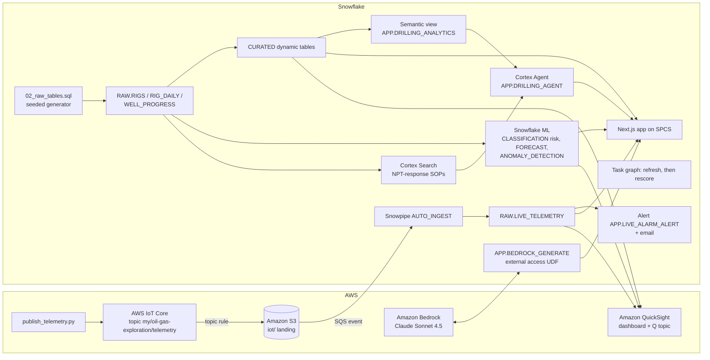

# Malaysia Offshore Exploration Drilling - Rig Productivity and NPT Risk

Drilling operations analytics for **30 rigs and units of a fictional offshore exploration and appraisal operator, working from 4 Malaysian supply bases** (Miri, Kemaman, Bintulu, Labuan) using Snowflake, optionally with AWS: from a live standpipe-pressure alarm to a 7-day non-productive-time (NPT) risk score, an alarm email and an AI action memo. The operator, its rigs and all data are synthetic; nothing here describes the performance of any real company, rig or field.

## Architecture

A drilling-operations pipeline built on **Snowflake** (Dynamic Tables, Snowflake ML, Cortex Search, Cortex Agent, Cortex AI_COMPLETE, SPCS) and, in the full build, **AWS** (IoT Core, S3, Bedrock Claude, QuickSight + Amazon Q). Rig-floor telemetry lands in `RAW.LIVE_TELEMETRY`. Dynamic tables curate 90 days of rig-day history: productive time, NPT events and hours, mud checks within an internal demo specification, metres drilled, diesel use and diesel intensity, well-control kicks and current-well depth progress. Snowflake ML scores 7-day NPT risk per rig, forecasts fleet-wide daily diesel use and flags standpipe-pressure anomalies. A Cortex Agent answers questions with SOP citations, and an LLM drafts the action memo.

Interactive diagrams (hover for object names): [Snowflake only](docs/architecture-snowflake.html) | [AWS + Snowflake](docs/architecture-aws.html). The app shows both on its Architecture & Data tab, the current build first. Regenerate them with `python3 docs/build_architecture.py`.



The Snowflake-only build drops the AWS subgraph: `APP.SIMULATE_TELEMETRY` writes to `RAW.LIVE_TELEMETRY`, and the app calls Cortex `AI_COMPLETE` instead of the Bedrock UDF.

## Snowflake Capabilities

| Capability | Implementation |
|-----------|---------------|
| Dynamic Tables | `CURATED.KPI_SUMMARY`, `PERFORMANCE_SUMMARY`, `NPT_CAUSES`, `TREND_ANALYSIS` from the RAW tables |
| Snowflake ML | CLASSIFICATION 7-day NPT risk (`ML.NPT_RISK_SCORES`), 14-day diesel-use FORECAST, standpipe-pressure ANOMALY_DETECTION |
| Cortex Search | 21 synthetic NPT-response SOPs (one per rig type and cause) in `SEARCH.WELL_SOP_SEARCH` |
| Semantic View | `APP.DRILLING_ANALYTICS` over rigs, NPT causes, daily totals and risk |
| Cortex Agent | `APP.DRILLING_AGENT`: Cortex Analyst over the semantic view plus Cortex Search for SOP citations |
| Cortex AI | `AI_COMPLETE('claude-sonnet-4-5')` for grounded answers, and for the action memo in the Snowflake-only build |
| Alerts + Tasks | `APP.LIVE_ALARM_ALERT` logs ALARM readings and sends email; task graph `TASK_REFRESH_CURATED`, then `TASK_RESCORE_RISK` |
| Snowpark Container Services | Next.js app `APP.MY_OIL_GAS_EXPLORATION_APP` with 6 tabs: Executive Cockpit, Predictive, Rig Health, Live IoT, Ask AI, Architecture & Data |
| Snowpipe | `RAW.LIVE_TELEMETRY_PIPE` AUTO_INGEST from S3 (AWS build only) |

## AWS Services

Used only in the AWS + Snowflake build.

| Service | Role in Demo |
|---------|-------------|
| AWS IoT Core | Receives simulated rig-floor telemetry (standpipe pressure, hookload). A topic rule writes each message to S3 |
| Amazon S3 | Landing bucket. An event notification goes to the Snowpipe SQS queue |
| Amazon Bedrock | Claude Sonnet 4.5 writes the action memo, called from Snowflake through an external-access UDF |
| Amazon QuickSight | DIRECT_QUERY executive dashboard over Snowflake (daily mud checks within spec, NPT events by rig, NPT risk) |
| Amazon Q | Natural-language questions over the QuickSight topic `my-oil-gas-exploration-topic` |
| AWS IAM | Least-privilege roles for S3, IoT and Bedrock |

## Personas

These personas are fictional.

| Persona | Role | Key Questions |
|---------|------|---------------|
| **Nurul Aina Rahman** | Head of Drilling Operations | "Which supply base has the lowest productive time?" "Which NPT causes cost the most rig hours?" |
| **Hafiz Lim** | Drilling Superintendent | "Which rigs are high NPT risk this week, and which SOP applies?" |

## Data

All data is synthetic and seeded, so every rebuild reproduces it. The operator and rig names are fictional; the four supply-base cities are real Malaysian cities used only as labels. Thresholds and specifications are internal demo values, not regulatory or contractual limits.

| Table | Rows | Description |
|-------|------|-------------|
| RAW.RIGS | 30 | Rigs and units across 4 supply bases and 5 types (Jack-up Rig, Semi-submersible Rig, Tender-assist Rig, Drillship, Hydraulic Workover Unit) |
| RAW.RIG_DAILY | 2,700 | Daily rig observations over 90 days: planned, productive and NPT hours, NPT events and root cause, BOP pressure tests, mud checks and checks within spec, metres drilled, diesel m3, kicks, standpipe pressure and hookload |
| RAW.WELL_PROGRESS | 30 | Planned and drilled depth of the current well per rig |
| SEARCH.WELL_SOP_DOCS | 21 | Synthetic NPT-response SOPs indexed for Cortex Search |
| RAW.LIVE_TELEMETRY | Grows during the demo | Live readings from IoT Core (AWS build) or `APP.SIMULATE_TELEMETRY` (Snowflake-only build) |
| ML.NPT_RISK_SCORES | 30 | 7-day NPT probability and risk band per rig |

## Build Instructions

### Prerequisites
- Snowflake account with ACCOUNTADMIN access, and Cortex AI enabled (AI_COMPLETE, Search, Agent).
- An X-Small warehouse with auto-suspend at or below 120 s, and an existing SPCS compute pool.
- Python 3.11+, `snowflake-connector-python`, Node.js 22+, Docker and the `snow` CLI.
- App image: run `snow spcs image-registry login`, then build and push `my-oil-gas-exploration-app:v1` to the database's `APP.IMAGES` repository (see the header of `snowflake/07_deploy_app.sql`).
- AWS build only: `boto3`, AWS credentials for the target account (us-west-2) with Bedrock access, and QuickSight Enterprise.

### SPCS App
```
<DATABASE>.APP.MY_OIL_GAS_EXPLORATION_APP
```

### Tests
```bash
python -m pytest aws snowflake quicksight
```

For a local run, put `SNOWFLAKE_ACCOUNT`, `SNOWFLAKE_USER`, `SNOWFLAKE_DATABASE`, `SNOWFLAKE_WAREHOUSE`, `SNOWFLAKE_AUTHENTICATOR=PROGRAMMATIC_ACCESS_TOKEN`, `SNOWFLAKE_TOKEN` and `DEMO_PLATFORM` in the environment, then run `npm --prefix app run build && npm --prefix app start`.

## Build Modes

Both modes share the same core. They differ in three places, and the app's `DEMO_PLATFORM` setting (in its SPCS spec) switches the memo provider and the Live IoT tab.

| Layer | Snowflake Only | Full AWS + Snowflake |
|---|---|---|
| Live telemetry | `CALL APP.SIMULATE_TELEMETRY(n)` inserts simulated readings into `RAW.LIVE_TELEMETRY`. This simulates a sensor feed; it is not Snowpipe Streaming | `aws/publish_telemetry.py` to AWS IoT Core, then S3, SQS and Snowpipe AUTO_INGEST |
| Action memo | Cortex `AI_COMPLETE('claude-sonnet-4-5')` | Amazon Bedrock Claude Sonnet 4.5 through `APP.BEDROCK_GENERATE` |
| BI and natural-language questions | The SPCS app is the dashboard; questions go to the Cortex Agent | Also a QuickSight dashboard and an Amazon Q topic |
| App setting | `DEMO_PLATFORM: snowflake` | `DEMO_PLATFORM: aws` |

### Snowflake Only

```bash
# 1. Core data and dynamic tables (guarded: new isolated database only)
python snowflake/run_core.py --database MALAYSIA_OIL_GAS_EXPLORATION_SNOWFLAKE --warehouse <XS_WAREHOUSE> --connection <CONNECTION> --apply
# 2. Native telemetry, ML, search, semantic view, agent, alert and task graph
python snowflake/run_intelligence.py --database MALAYSIA_OIL_GAS_EXPLORATION_SNOWFLAKE --platform snowflake --warehouse <XS_WAREHOUSE> --connection <CONNECTION> --alert-email you@example.com
# 3. App on SPCS with DEMO_PLATFORM=snowflake (push the image first)
python snowflake/run_intelligence.py --database MALAYSIA_OIL_GAS_EXPLORATION_SNOWFLAKE --platform snowflake --warehouse <XS_WAREHOUSE> --connection <CONNECTION> --alert-email you@example.com --files 07_deploy_app.sql --compute-pool <COMPUTE_POOL>
```

During the demo:
- Run `CALL APP.SIMULATE_TELEMETRY(20)` to add live readings. For a continuous feed, run `ALTER TASK APP.TASK_SIMULATE_TELEMETRY RESUME`, and `SUSPEND` it afterwards.
- Run `EXECUTE ALERT APP.LIVE_ALARM_ALERT` to raise the alarm email.
- Run `EXECUTE TASK APP.TASK_REFRESH_CURATED` to refresh the curated tables and rescore risk.

Afterwards, drop the database or run `ALTER SERVICE APP.MY_OIL_GAS_EXPLORATION_APP SUSPEND`.

### Full AWS + Snowflake

```bash
# 1. Core data and dynamic tables (guarded: new isolated database only)
python snowflake/run_core.py --database MALAYSIA_OIL_GAS_EXPLORATION_AWS --warehouse <XS_WAREHOUSE> --connection <CONNECTION> --apply
# 2. AWS ingestion and Bedrock (dry run first, then --apply)
python aws/setup_aws.py --database MALAYSIA_OIL_GAS_EXPLORATION_AWS --account <AWS_ACCOUNT_ID> --connection <CONNECTION> --apply
# 3. ML, search, semantic view, agent, alert and task graph
python snowflake/run_intelligence.py --database MALAYSIA_OIL_GAS_EXPLORATION_AWS --platform aws --warehouse <XS_WAREHOUSE> --connection <CONNECTION> --alert-email you@example.com
# 4. App on SPCS with DEMO_PLATFORM=aws (push the image first)
python snowflake/run_intelligence.py --database MALAYSIA_OIL_GAS_EXPLORATION_AWS --platform aws --warehouse <XS_WAREHOUSE> --connection <CONNECTION> --alert-email you@example.com --files 07_deploy_app.sql --compute-pool <COMPUTE_POOL>
# 5. QuickSight dashboard and Q topic (needs an existing Snowflake data source)
python quicksight/build_dashboards.py --database MALAYSIA_OIL_GAS_EXPLORATION_AWS --account <AWS_ACCOUNT_ID> --principal-arn <QUICKSIGHT_USER_ARN> --data-source-arn <DATA_SOURCE_ARN> --prefix my-oil-gas-exploration --apply --update --with-topic
```

QuickSight objects must be shared with the QuickSight user who signs in (`--principal-arn`); otherwise the console shows nothing.

During the demo:
- Run `python aws/publish_telemetry.py --count 20` to send live readings.
- Run `EXECUTE ALERT APP.LIVE_ALARM_ALERT` to raise the alarm email.
- Run `EXECUTE TASK APP.TASK_REFRESH_CURATED` to refresh the curated tables and rescore risk.

Afterwards, `python aws/teardown_aws.py --database MALAYSIA_OIL_GAS_EXPLORATION_AWS --account <AWS_ACCOUNT_ID> --connection <CONNECTION> --apply` removes the AWS resources and the account-level Bedrock external-access and S3 storage integrations. It leaves the email integration `MY_OIL_GAS_EXPLORATION_EMAIL_INT`, which the Snowflake-only build also uses.

## Business Impact

Industry research:
- **Oil and gas operations carry a large emissions footprint**: "The production, transport and processing of oil and gas results in just under 15% of global energy-related greenhouse gas emissions." -- [IEA, The Oil and Gas Industry in Net Zero Transitions, executive summary](https://www.iea.org/reports/the-oil-and-gas-industry-in-net-zero-transitions/executive-summary)
- **Supply investment continues in every scenario**: "Continued investment in oil and gas supply is needed in all scenarios" -- [IEA, The Oil and Gas Industry in Net Zero Transitions, executive summary](https://www.iea.org/reports/the-oil-and-gas-industry-in-net-zero-transitions/executive-summary)

## Key Demo Numbers

These figures are synthetic and come from the seeded demo data. Forecast and anomaly figures can shift slightly with the build day.

- **30 rigs and units**, 2,700 rig-days over 90 days, across 4 supply bases and 5 rig types; **307,199 metres drilled** and **48,589 mud checks**
- **Productive time 97.8%**; per-rig values range from 90.7% to 100%, and Labuan is the lowest supply base at 96.7%
- **378 NPT events** costing 1,405 NPT hours across 13 root causes; snubbing equipment faults cost the most time (281.1 hours)
- **Mud checks within spec 87.9%**; per-rig values range from 80.1% to 91.3%
- **Diesel intensity 209.5 L/m** (64,354 m3 in total); drillships are highest at 313.5 L/m
- **NPT-risk model** out-of-time holdout: precision 0.54, recall 0.61 at a 0.5 threshold, against a 0.39 base rate. 17 rigs are high risk; the top rig is RG-0005, at 99.4%
- **14-day diesel forecast** of 612 to 740 m3 per day with prediction intervals; **29 of 480** rig-days flagged as standpipe-pressure anomalies
- **Current-well depth progress 57.0%**, 25 well-control kicks
- **21 SOPs** indexed for Cortex Search and cited by ID in agent answers

## License

Apache 2.0 — See [LICENSE](LICENSE) for details.

This is a personal demo project and is not an official Snowflake offering. It comes with no support or warranty. The operator, rigs and figures are synthetic and do not describe any real company, rig or field. Industry statements cited are from publicly available third-party research; they are context, not guarantees of results.
